<div align="center">




<a href="https://www.prismaisol.com/"></a>
<a href="https://prismai-reach.vercel.app/"></a>
<a href="https://www.linkedin.com/in/radoslav-kolchev-022075155/"></a>

</div>

<br/>

### `> whoami`

```ts
const radoslav = {
  building:  "Voice AI agents @ PrismAI",
  agents:    ["reception", "customer support", "sales", "follow-ups",
              "scheduling", "reminders", "CRM automation", "...whatever you need"],
  languages: 72,
  uptime:    "24/7",
  team:      1,          // solo.
  based:     "Bulgaria",
};
```

### `> ls ~/products`

**[PrismAI Solutions](https://www.prismaisol.com/)** — custom voice AI agents that take over a business's phone line end to end: inbound calls, outbound calls, bookings, support, CRM updates.

**[PrismAI Reach](https://prismai-reach.vercel.app/)** — upload a customer list and the agent calls every contact, handles the conversation, and logs the outcome. Humans only step in when it actually matters.

### `> cat clients.txt`

Odds are my agents already work for whoever services your car and makes your food.

```
Toyota · Mototom
Agrozastrahovane.bg
WOW Tea
Happy Bar & Grill
```

<sub>built solo.</sub>

### `> ls ~/stack`


### `> git log --stat`

<div align="center">


</div>

<picture>
  <source media="(prefers-color-scheme: dark)" srcset="https://raw.githubusercontent.com/calibro7/calibro7/output/snake-dark.svg"/>
  <source media="(prefers-color-scheme: light)" srcset="https://raw.githubusercontent.com/calibro7/calibro7/output/snake.svg"/>
  
</picture>

<details>
<summary><sub>previously</sub></summary>

<br/>

Web3 — Solidity, Hardhat, React dApps.
<sub>[token-exchange](https://github.com/calibro7/token-exchange) · [ai-nft-dapp](https://github.com/calibro7/ai-nft-dapp) · [resume](https://github.com/calibro7/resume)</sub>

</details>

<div align="center">
<br/>

<br/>
<sub>building something that needs a voice? → <a href="https://www.prismaisol.com/">prismaisol.com</a></sub>
</div>
